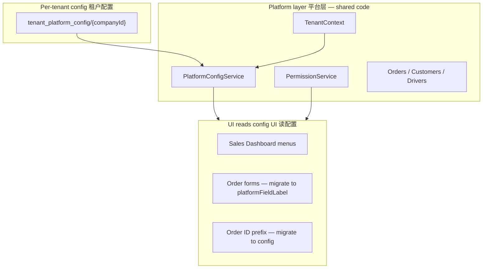

# EmberCore — Generic Platform & SaaS Customization

**EmberCore** is a **multi-tenant operations platform** (appointments, field service, transport, POS, billing).  
Industry-specific behaviour is **not hard-coded in the UI** long-term — it is configured per tenant in Firestore.

花店能力保留为 **`industry_key: florist`** 预设；新 SaaS 客户默认 **`generic`** 预设。

| Doc | Topic |
|-----|-------|
| [SAAS_ROADMAP.md](SAAS_ROADMAP.md) | Launch phases |
| [INTERNAL_TO_SAAS_ERP.md](INTERNAL_TO_SAAS_ERP.md) | 内部 ERP → SaaS 分段清单 |
| [PERMISSION_MATRIX.md](PERMISSION_MATRIX.md) | RBAC (unchanged) |
| [DATABASE_SCHEMA.md](DATABASE_SCHEMA.md) | Firestore collections |

---

## 1. Architecture / 架构



| Layer | Responsibility |
|-------|----------------|
| **Platform** | Auth, multi-tenant, orders, drivers, invoices, RBAC |
| **Tenant config** | Modules on/off, labels, order types, ID prefix, industry preset |
| **Vertical UI** | Still being migrated from florist strings → `platformFieldLabel()` |

---

## 2. Firestore: `tenant_platform_config`

**Document ID** = `companyId` (same as `role_permissions`).

### Example — generic field service tenant

```json
{
  "industry_key": "generic",
  "order_id_prefix": "EC",
  "order_types": ["OnSite", "WalkIn", "Remote"],
  "enabled_modules": [
    "orders", "pos", "fieldService", "drivers",
    "customers", "invoices", "products", "reports", "customerBroadcast"
  ],
  "field_labels_en": {
    "recipientName": "Site contact",
    "serviceNotes": "Work order notes",
    "scheduledDate": "Appointment date"
  },
  "field_labels_zh": {
    "recipientName": "现场联系人",
    "scheduledDate": "预约日期"
  },
  "driver_role_label_en": "Field staff",
  "driver_role_label_zh": "外勤人员"
}
```

### Example — legacy florist (existing behaviour)

```json
{
  "industry_key": "florist"
}
```

Omitting the document → **generic defaults** (no WhatsApp import, no materials/BOM on dashboard).

---

## 3. Code reference / 代码入口

| File | Purpose |
|------|---------|
| `lib/platform/tenant_platform_config.dart` | Parse defaults, presets, Firestore map |
| `lib/platform/platform_module.dart` | Module enum (`orders`, `drivers`, `materialsBom`, …) |
| `lib/platform/platform_config_service.dart` | Load/stream config per active company |
| `lib/platform/platform_labels.dart` | `platformFieldLabel()`, `platformModuleEnabled()` |
| `lib/backend/tenant_context.dart` | Loads config on company switch |
| `lib/app_branding.dart` | Product tagline (platform-level, not per tenant) |

### Modules (`PlatformModule`)

| Module | Generic default | Florist preset |
|--------|-----------------|----------------|
| `orders` | ✅ | ✅ |
| `pos` | ✅ | ✅ |
| `fieldService` | ✅ | ✅ |
| `drivers` | ✅ | ✅ |
| `customers` | ✅ | ✅ |
| `invoices` | ✅ | ✅ |
| `products` | ✅ | ✅ |
| `reports` | ✅ | ✅ |
| `customerBroadcast` | ✅ | ✅ |
| `materialsBom` | ❌ | ✅ |
| `productionMenu` | ❌ | ✅ |
| `shopifyImport` | ❌ | ✅ |
| `whatsappImport` | ❌ | ✅ |
| `appointments` | ❌ (reserved) | ❌ |

---

## 4. UI integration pattern / UI 接入方式

### Hide a menu by module

```dart
import '/platform/platform_labels.dart';
import '/platform/platform_module.dart';

if (platformModuleEnabled(PlatformModule.whatsappImport)) {
  WhatsAppOrderPasteButton(...);
}
```

**Already wired:** Sales Dashboard — WhatsApp paste, Material list, Material usage report.

### Custom field label

```dart
Text(platformFieldLabel(context, PlatformFieldKey.scheduledDate))
// generic tenant → "Scheduled date" / "预约日期"
// florist tenant → "Delivery date" / "配送日期"
```

**TODO (incremental):** `create_order_form`, `edit_order_details`, PDF/thermal printers.

---

## 5. Generic vs florist data model / 数据模型说明

Firestore **order fields are unchanged** (`recipient_name`, `delivery_date`, `card_message`, …).  
Generic tenants use **neutral labels** in the UI; the same fields mean:

| Firestore field | Generic meaning |
|-----------------|-----------------|
| `recipient_name` | Site contact |
| `recipient_phone_number` | Contact phone |
| `card_message` | Service notes |
| `delivery_date` | Scheduled / appointment date |
| `delivery_time_slot` | Time window |
| `address` | Service address |

Order **type strings** in generic config: `OnSite`, `WalkIn`, `Remote`.  
Legacy florist: `Delivery`, `Retail`, `PickUp` (filters still accept both during migration).

Order **IDs** still use `TFG-` in code until `order_id_service.dart` reads `order_id_prefix` from config (planned).

---

## 6. SaaS customize roadmap / 定制路线图

| Phase | What | Status |
|-------|------|--------|
| **A** | `tenant_platform_config` + service + tests | ✅ Done |
| **B** | Dashboard module gates | ✅ Started |
| **C** | Forms & PDFs use `platformFieldLabel` | ⬜ Incremental |
| **D** | `order_id_service` reads `order_id_prefix` | ⬜ |
| **E** | Superadmin **Industry settings** UI | ✅ Done |
| **F** | Configurable status pipeline | ⬜ |
| **G** | `appointments` module (calendar/resources) | ⬜ |

---

## 7. Bootstrap a new tenant

After creating `Companies/{id}`:

1. Optionally set `tenant_platform_config/{id}` (or rely on generic defaults).
2. Set `role_permissions/{id}` and counters as today.
3. For florist migration, only add: `{ "industry_key": "florist" }`.

```javascript
// Firebase Console or admin script
db.collection('tenant_platform_config').doc('YOUR_COMPANY_ID').set({
  industry_key: 'generic',
  order_id_prefix: 'EC',
});
```

---

## 8. Permissions vs platform config

| Concern | System |
|---------|--------|
| **Who can do X** | `AppPermission` + `role_permissions` (unchanged) |
| **What features exist for this tenant** | `PlatformConfigService` modules |
| **What labels say** | `field_labels_*` in tenant config |

A user may have `viewOrders` but if `orders` module is off, hide entry points (when fully migrated).

---

*Generic platform guide · EmberCore by EmberSoulLabs · v1.0.3 (10)*
