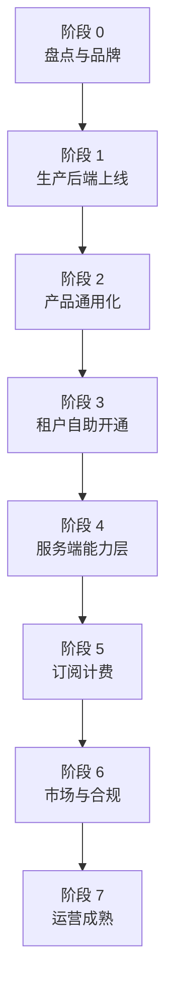

# 内部 ERP → SaaS ERP 分段改造清单

**产品：** EmberCore · **公司：** EmberSoulLabs · **Firebase：** `embercore-erp`  
**用途：** 把「自用 / 单租户花店 ERP」演进为「多租户、可自助开通、可收费的 SaaS ERP」。  
完成一项勾一项 `[x]`。

**相关文档：** [SAAS_EXECUTION_PLAN.md](SAAS_EXECUTION_PLAN.md)（分段执行计划）· [PRICING_PLANS.md](PRICING_PLANS.md)（套餐与功能分层）· [STRIPE_BILLING_SETUP.md](STRIPE_BILLING_SETUP.md) · [SAAS_ROADMAP.md](SAAS_ROADMAP.md) · [GENERIC_PLATFORM.md](GENERIC_PLATFORM.md) · [PERMISSION_MATRIX.md](PERMISSION_MATRIX.md)

---

## 总览：内部 ERP 与 SaaS ERP 差什么？

| 维度 | 内部 ERP（现状起点） | SaaS ERP（目标） |
|------|----------------------|------------------|
| **租户** | 1 家花店 / 手动建 `Companies` | 多租户隔离 + 自助申请开通 |
| **账号** | 管理员 Console / 脚本加人 | 注册 → 审批 → 自动建 director |
| **产品** | UI/订单号偏 TFG 花店 | `tenant_platform_config` 按行业配置 |
| **后端** | 主要靠客户端 + Firestore 规则 | Cloud Functions 负责开通、计费、Webhook |
| **收费** | 无 | 套餐、试用、到期限制 |
| **对外** | 无官网 / 无法律页 | embersoullabs.com + 应用商店 |
| **运营** | 开发者改 Firestore | superadmin 在 App 内审批、行业设置 |

**建议顺序：** 1 → 2 与 3 可并行 → **4 必须在 3 规模化前完成** → 5、6 可部分重叠。

---

## 阶段 0 — 盘点与品牌（大部分已完成）

> **目标：** 代码库、Firebase 项目、品牌与「多租户平台」数据模型就位。  
> **完成标志：** 新 Firebase 项目可连接；平台配置层可读；品牌为 EmberCore。

### 0.1 品牌与客户端

- [x] 产品名 **EmberCore**（`lib/app_branding.dart`）
- [x] Android / iOS / Web 显示名与 Bundle ID 更新
- [x] Firebase 客户端指向 `embercore-erp`（`firebase_config.dart` 等）
- [ ] 全项目外显文案统一（邮件、PDF、错误提示无遗留 TFG VDAY）

### 0.2 多租户与权限（已有，维持）

- [x] `TenantContext` 公司切换 / superadmin 全公司视图
- [x] RBAC：`role_permissions` + `PermissionService`（33 权限）
- [x] 司机路由隔离、审计日志、员工管理

### 0.3 平台配置层（SaaS 定制基础）

- [x] `tenant_platform_config/{companyId}` 数据模型
- [x] `PlatformConfigService` 加载 / 保存
- [x] 预设：`generic` / `florist` / `fieldService` / `transport`
- [x] 仪表盘按模块开关（WhatsApp、物料等）
- [x] 单元测试 `test/tenant_platform_config_test.dart`
- [x] superadmin **行业设置**页 `/industrySettings`

### 0.4 文档

- [x] [SAAS_ROADMAP.md](SAAS_ROADMAP.md)
- [x] [GENERIC_PLATFORM.md](GENERIC_PLATFORM.md)
- [x] 本文档

---

## 阶段 1 — 生产后端上线

> **目标：** `embercore-erp` 具备完整 Rules、Functions、Hosting；三端跑通核心流程。  
> **完成标志：** superadmin 登录 → 选公司 → 建单 → 改状态 → 打印；**无需**手改 Firestore。

### 1.1 部署目录与工具

- [ ] 从 `tfg_vday` 复制 `firebase/` 到本仓库（排除 `node_modules`、`keys/*.json`）
- [ ] `firebase/.firebaserc` → `production: embercore-erp`
- [ ] `npm install`（`firebase/` + `firebase/functions/`）
- [ ] Service Account → `firebase/keys/`（**勿提交 git**）
- [ ] Blaze 计划（Functions 必需）

### 1.2 Console 服务

- [ ] Auth：Email/Password
- [ ] Firestore（建议 `asia-southeast1`）
- [ ] Storage、Hosting、FCM、Crashlytics、Performance
- [ ] App Check：**监控模式**（暂不强制）

### 1.3 部署

- [ ] `firestore.rules` + `firestore.indexes`
- [ ] `storage.rules` + CORS（Web 上传图）
- [ ] Cloud Functions（`shopifyOrderCreated`、员工通知 FCM 等）
- [ ] `flutter build web` → Hosting 部署
- [ ] `npm run test:firebase` 通过（推荐）

### 1.4 平台种子数据

- [ ] superadmin：`users/{uid}` + Auth
- [ ] 演示租户：`Companies` + counters + `role_permissions` + `staff_roles`
- [ ] 至少 1 个测试商品

### 1.5 冒烟（Web + 至少一端移动）

- [ ] 零售 POS、配送单全流程
- [ ] 客户 CRUD、发票、报表导出
- [ ] 司机仅见配送页
- [ ] 离线队列重连
- [ ] **租户隔离**：非 superadmin 不可读其他 `companyRef`

---

## 阶段 2 — 产品通用化（去「单店花店」硬编码）

> **目标：** 同一套 App 通过配置服务多行业；新租户默认 `generic`，花店用 `florist` 预设。  
> **完成标志：** 新租户无 TFG 文案/前缀；订单表单与打印读 `platformFieldLabel` / `order_id_prefix`。

### 2.1 订单与编号

- [x] `order_id_service.dart` 读取 `tenant_platform_config.order_id_prefix`（替代写死 `TFG-`）— 生成读 active config，检测改为前缀无关结构化匹配，客户号接受 `prefix` 参数；⚠️ 老花店租户须先配 `industry_key: florist`/`order_id_prefix: TFG`（见 2.5），否则单号会变 `EC-`
- [x] 订单类型筛选兼容 `OnSite/WalkIn/Remote` 与 `Delivery/Retail/PickUp`
- [x] 新建租户默认前缀 `EC`（已在 generic 预设）

### 2.2 表单与文案

- [x] `create_order_form` — 字段标签用 `platformFieldLabel()`
- [x] `edit_order_details` / 客户表单 — 同上（edit_order_details 已完成；customer 表单无花店专用字段）
- [x] PDF / 热敏小票 / 配送单 — 租户公司名 + Logo + 字段标签（PDF recipient 段；公司名/Logo 原有）
- [x] 司机角色显示名读 `driver_role_label_*`（侧栏 nav.delivery）

### 2.3 状态与行业

- [ ] 订单状态文案可配置（`status_labels_en` 扩展 UI）
- [ ] （可选）可配置状态流转管道
- [ ] （远期）`appointments` 模块：预约日历

### 2.4 模块与菜单

- [x] 仪表盘模块门控（部分）
- [x] 全站菜单项均经 `platformModuleEnabled()`（订单列表、报表、集成入口）
- [x] 关闭模块时 API/写入层二次校验（防深链）— 建单 + WhatsApp 导入

### 2.5 数据迁移（现有花店租户）

- [ ] 生产花店 `Companies` 增加 `tenant_platform_config`：`{ "industry_key": "florist" }`
- [ ] 验证行为与改造前一致（TFG 前缀、WhatsApp、物料）

---

## 阶段 3 — 租户自助开通（Onboarding）

> **目标：** 陌生人 `/userSignup` → superadmin 审批 → director 能登录建单，**尽量**无 Console 手改。  
> **完成标志：** 端到端开通一家新花店/通用租户，全程在 App + 自动化完成。

### 3.1 注册申请（C 端）

- [x] `/userSignup` 页面
- [x] 写入 `user_registration_requests`（`status: pending`）
- [x] Firestore 规则：申请人可 **create**，不可读他人
- [x] Storage 规则：`user_registration_logos/`
- [ ] 注册页 `loc()` 补全 `ms` 等 i18n（当前 analyze 有遗留）
- [x] 登录页策略（SaaS 模式保留「还没注册？」链接 — 见 `login_page_widget.dart`）

### 3.2 审批（平台运营 — App 内，非独立后台）

- [x] superadmin **注册审批**页 `/registrationRequests`
- [x] 列表筛选 pending / approved / rejected
- [x] 详情、Logo、批准 / 拒绝
- [x] 批准时客户端创建公司 + `tenant_platform_config` + director（MVP）
- [x] **改为 Cloud Function 批准**（见阶段 4）— `approveRegistrationRequest` 服务端开通，superadmin 不再被登出；支持传初始密码或无密码（返回 reset link）

### 3.3 租户生命周期（运营）

- [x] superadmin **租户列表**（公司数、状态、创建时间、员工数）— `/tenantList`
- [x] 一键停用租户 `Companies.is_active = false` → 员工无法登录
- [x] superadmin 不经过注册流直接建租户（内部演示 / 大客户）
- [ ] 租户数据导出（合规下线）

### 3.4 测试环境

- [ ] `embercore-erp-staging` 项目
- [ ] 规则 / Functions / Hosting 部署到 staging
- [ ] 流程：**staging 冒烟 → production 发布**

---

## 阶段 4 — 服务端能力层（真正的「后台」）

> **目标：** 客户端不做的事交给 Cloud Functions；开通、计费、集成回调可靠、可审计。  
> **完成标志：** 批准注册不依赖客户端创建 Auth；关键写操作有服务端日志。

**说明：** 不必单独做 React 管理后台；Flutter superadmin 页 + Functions 即可。

### 4.1 注册开通 Function

- [x] `approveRegistrationRequest` Callable（`firebase/functions/registration_provisioning.js`）
- [x] Admin SDK：创建 Auth（传入初始密码）或无密码 + `generatePasswordResetLink`
- [x] 原子写入：`Companies`、`counters`、`role_permissions`、`staff_roles`、`tenant_platform_config`、`product_categories`（单 batch）+ `users`
- [x] 失败回滚（删除已建租户文档/Auth），`user_registration_requests` 末尾才更新，保持 `pending`
- [x] 记录 `reviewed_by_uid`、`provisioned_company_ref`、`provisioned_user_uid`

### 4.2 安全与规则补强

- [ ] `tenant_platform_config`：superadmin 写，租户只读
- [ ] `user_registration_requests`：superadmin 读写，匿名/登录用户 create
- [ ] 禁止客户端直接 `set` 他人 `users/{uid}`（除 staff_registration_intent 流程）
- [ ] App Check 由监控改为**强制**（Web + 移动稳定后）

### 4.3 集成与自动化

- [ ] Shopify Webhook → 新项目的 Function URL
- [ ] WhatsApp / 其他 Webhook 密钥按租户或平台配置
- [ ] 定时任务：试用到期提醒、订阅状态同步
- [ ] 欢迎邮件 / 审批结果通知（SendGrid / Firebase Extensions）

### 4.4 可观测性

- [ ] Functions 日志与告警（开通失败率）
- [ ] 平台级审计：租户创建、停用、套餐变更

---

## 阶段 5 — 订阅计费

> **目标：** EmberSoulLabs 向租户收月费/年费；到期限制写操作。  
> **完成标志：** 测试租户订阅 Pro → 到期后无法新建订单并提示续费。

### 5.1 套餐设计

> 已定稿分层见 [PRICING_PLANS.md](PRICING_PLANS.md)（Starter / Pro / Business · **MYR** · 功能矩阵）

- [x] 档位与功能分层文档（Starter / Pro / Business）
- [ ] Stripe 三档 Price ID + Functions `PLAN_LIMITS` 对齐（2 员工 / 2000 单）
- [ ] 按 `plan_tier` 锁 `PlatformModule`（WhatsApp/Shopify 等 Pro 起）
- [ ] 客户群发额度字段与校验
- [ ] 免费试用 14 天（已有 trialing 逻辑）

### 5.2 数据模型

在 `Companies` 或 `subscriptions/{companyId}`：

- [ ] `plan_tier`、`subscription_status`（trialing / active / past_due / cancelled）
- [ ] `trial_ends_at`、`current_period_end`
- [ ] `stripe_customer_id` / 本地 PSP ID
- [ ] `max_staff_seats`、`max_orders_per_month`

### 5.3 支付（马来西亚）

- [ ] Stripe 和/或 Billplz / ToyyibPay / Revenue Monster
- [ ] Webhook Function：支付成功 / 失败 → 更新订阅状态
- [ ] App 内 **Billing** 页（director）：当前套餐、续费、升级

### 5.4 用量与限制

- [ ] 超量订单 / 超人数提示
- [ ] `past_due` / `cancelled`：只读或禁止建单（与 `PlatformModule` 联动）
- [ ] superadmin 手动延期 / 赠送试用

### 5.5 财务

- [ ] EmberSoulLabs 开 SaaS 发票（与租户对客户的发票分离）
- [ ] SST / 会计导出（如适用）

---

## 阶段 6 — 市场、合规与分发

> **目标：** 陌生人从官网了解产品 → 注册试用 → 合法签约。  
> **完成标志：** 官网 pricing → `/userSignup` → 14 天内首单 → 收到续费提示并可付款。

### 6.1 官网 embersoullabs.com

- [ ] 首页：价值主张 + 截图/演示
- [ ] 功能页、**定价页**、关于（SSM）
- [ ] CTA → `app.embersoullabs.com` 或 `/userSignup`

### 6.2 应用分发

- [ ] Web 自定义域名 `app.embersoullabs.com`
- [ ] Google Play / App Store 上架（隐私政策 URL）
- [ ] （可选）旺季直连 APK

### 6.3 法律（马来西亚）

- [ ] 服务条款 Terms of Service
- [ ] 隐私政策 Privacy Policy（PDPA 2010）— 草案见 [legal/PRIVACY_POLICY_DRAFT.md](legal/PRIVACY_POLICY_DRAFT.md)，律师审后发布
- [ ] Cookie 政策（Web）
- [ ] 数据处理协议 DPA 模板（B2B）
- [ ] 注册勾选同意

### 6.4 客户成功

- [ ] support@embersoullabs.com
- [ ] 工单或表单
- [ ] 中英文入门文档 + 短视频
- [ ] 3–5 家试点客户反馈闭环

### 6.5 分析

- [ ] 漏斗：官网 → 注册 → 激活 → 付费
- [ ] 邮件：试用将尽、产品更新

---

## 阶段 7 — 运营成熟（SaaS 长期）

> **目标：** 少人工、可扩展、可卖更多行业。  
> **完成标志：** 新客户从注册到付费 predominantly 自助；平台团队以审批异常为主。

- [ ] 租户健康度看板（活跃、订单量、续费率）
- [ ] 功能开关 + A/B（按 `plan_tier` 或 `industry_key`）
- [ ] 白标：租户子域名或独立 App（Enterprise）
- [ ] 多区域 Firebase / 数据驻留（企业客户）
- [ ] 公开 API / Webhook（Enterprise）
- [ ] SLA 与高峰季运行手册（已有 [RUNBOOK_PEAK_OPERATIONS.md](RUNBOOK_PEAK_OPERATIONS.md) 可扩展）

---

## 附录 A — 当前进度快照（2026-06-23）

| 能力 | 状态 |
|------|------|
| 多租户 ERP 核心（订单/POS/司机/发票/报表） | ✅ 已有 |
| EmberCore 品牌 + `embercore-erp` 客户端 | ✅ |
| `tenant_platform_config` + 行业设置 UI | ✅ |
| 注册申请 `/userSignup` | ✅ |
| 注册审批 UI `/registrationRequests` | ✅ |
| 租户列表 `/tenantList` + 停用 | ✅ |
| superadmin 手动建租户 `add_company_dialog` | ✅ |
| `firebase/` 部署目录在本仓库 | ✅ |
| `embercore-erp` 生产部署 + 冒烟 | ⬜ 进行中 |
| Cloud Function 自动开通（`approveRegistrationRequest`） | ✅ 代码完成，**待 deploy 验证** |
| 订单号去 TFG 硬编码（`order_id_service`） | ✅ |
| WhatsApp 导入读 `order_id_prefix` | ✅ |
| 表单/打印读 `platformFieldLabel` | ✅ 建单/编辑/PDF |
| 菜单模块门控 + 建单写入校验 | ✅ |
| 订阅计费 | ⬜ |
| 官网 + 法律文档 | ⬜ |

**按周执行：** 见 [SAAS_EXECUTION_PLAN.md](SAAS_EXECUTION_PLAN.md)

---

## 附录 B — 关键代码路径

| 用途 | 路径 |
|------|------|
| 租户上下文 | `lib/backend/tenant_context.dart` |
| 平台配置 | `lib/platform/` |
| 行业设置 | `lib/pages/industry_settings_page/` |
| 注册申请 | `lib/pages/user_signup_page/` |
| 注册审批 | `lib/pages/registration_requests_page/` |
| 审批服务 | `lib/backend/registration_approval_service.dart` |
| 员工注册 | `lib/auth/register_user_service.dart` |
| Firebase 客户端 | `lib/backend/firebase/` |
| 公司开通 | `lib/backend/company_provisioning_service.dart` |
| 手动建租户 | `lib/components/add_company_dialog.dart` |
| 后端部署 | `firebase/` |

---

## 附录 C — 建议时间线

| 阶段 | 预估 | 依赖 |
|------|------|------|
| 0 盘点 | — | 大部分已完成 |
| 1 生产后端 | 3–7 天 | Service Account、复制 firebase/ |
| 2 产品通用化 | 2–4 周 | 可与 3 并行 |
| 3 租户开通 | 1–2 周 UI 已完成；+1 周 Function | 1 |
| 4 服务端能力 | 1–2 周 | **3 规模化前必做** |
| 5 计费 | 2–3 周 | 4、商户号 |
| 6 市场合规 | 2–4 周 | 可与 5 重叠 |
| 7 运营成熟 | 持续 | 付费客户后 |

---

## 附录 D — 决策备忘

| 问题 | 建议 |
|------|------|
| 要不要单独做 Web 管理后台？ | **暂不**。Flutter superadmin + Functions 够用。 |
| 登录页要不要注册链接？ | **SaaS 要**；纯内部可隐藏。 |
| 先通用化还是先开通？ | **先 1 上线 + 3 最小闭环**，2 与 4 跟上；否则新客户看到 TFG 文案。 |
| 花店老租户怎么办？ | `industry_key: florist` 一条配置即可，无需 fork 代码。 |

---

*EmberCore by EmberSoulLabs · 内部 ERP → SaaS ERP 分段清单 · 2026-06-18*
