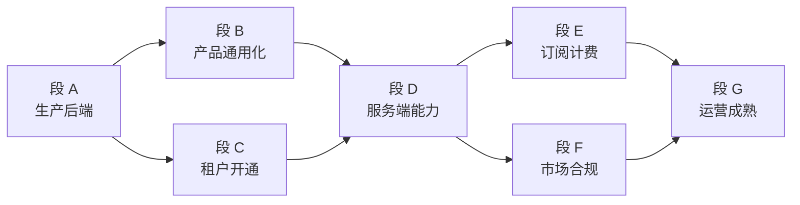

# EmberCore — SaaS 分段执行计划

**产品：** EmberCore · **公司：** EmberSoulLabs · **Firebase：** `embercore-erp`  
**用途：** 按周/按段推进「内部 ERP → 可售卖 SaaS」的可执行任务列表。  
**关联清单：** [INTERNAL_TO_SAAS_ERP.md](INTERNAL_TO_SAAS_ERP.md)（勾选式需求清单）· [SAAS_ROADMAP.md](SAAS_ROADMAP.md)

**最后更新：** 2026-06-24

---

## 如何使用本文档

| 文档 | 作用 |
|------|------|
| [INTERNAL_TO_SAAS_ERP.md](INTERNAL_TO_SAAS_ERP.md) | **做什么** — 分段需求清单，完成一项勾一项 |
| **本文档** | **怎么做、何时做** — 工期、依赖、验收标准、关键文件 |
| [SMOKE_TEST_LOG.md](SMOKE_TEST_LOG.md) | 段 A 冒烟结果记录 |

**执行原则：** 段 A →（B ∥ C）→ **D 必在规模化前** → E、F 可部分重叠 → G 持续迭代。

---

## 总览

| 段 | 名称 | 工期 | 当前进度 | 完成标志 |
|----|------|------|----------|----------|
| **A** | 生产后端上线 | 3–7 天 | ~75% | `embercore-erp` 全流程冒烟通过 |
| **B** | 产品通用化 | 2–4 周 | ~35% | 新租户无 TFG，读平台配置 |
| **C** | 租户开通闭环 | 1–2 周 | ~55% | 陌生人注册 → 审批 → 建单 |
| **D** | 服务端能力层 | 1–2 周 | ~45% | 批准走 Cloud Function（D1 完成，待部署） |
| **E** | 订阅计费 | 2–3 周 | 0% | 试用到期后限制建单 |
| **F** | 市场与合规 | 2–4 周 | 0% | 官网 → 注册 → 付款合法闭环 |
| **G** | 运营成熟 | 持续 | 0% | 付费客户后迭代 |

### 里程碑

| 里程碑 | 目标时间 | 含义 |
|--------|----------|------|
| **M1** | ~1 周 | 段 A 完成 — 可在 `embercore-erp` 稳定运营 |
| **M2** | ~4–6 周 | 段 A+B+C+D — **技术 SaaS**（可接租户，暂不收费） |
| **M3** | ~8–12 周 | +段 E+F — **可收费 SaaS MVP** |



---

## 段 A — 生产后端上线（第 1 周）

> **目标：** `embercore-erp` 具备完整 Rules、Functions、Hosting；三端跑通核心流程。  
> **完成标志：** superadmin 登录 → 选公司 → 建单 → 改状态 → 打印；**无需**手改 Firestore。

### A1 环境与工具（第 1–2 天）

| # | 任务 | 状态 | 备注 |
|---|------|------|------|
| A1.1 | 确认 `firebase/` 在仓库 | ✅ | 目录完整 |
| A1.2 | `npm install`（`firebase/` + `firebase/functions/`） | ✅ | 2026-06-24 验证通过 |
| A1.3 | `.firebaserc` → `production: embercore-erp` | ✅ | 已配置 |
| A1.4 | Service Account → `firebase/keys/` | ✅ | `embercore-erp-serviceAccount.json` 已就位（未提交 git） |
| A1.5 | Firebase Console 开 Blaze 计划 | ✅ | Functions 已部署，确认 Blaze 已启用 |
| A1.6 | 规划 staging 项目 | ✅ | 已创建 `embercore-erp-staging`，`.firebaserc` staging alias 已更新 |

### A2 Console 服务（第 2 天）

| 服务 | embercore-erp 状态 | 备注 |
|------|-------------------|------|
| Auth Email/Password | ✅ | 已有 superadmin / director 账号 |
| Firestore | ✅ | `(default)` 库，含 12 个 collection |
| Storage | ✅ | `gs://embercore-erp.firebasestorage.app` |
| Hosting | ✅ | https://embercore-erp.web.app |
| Cloud Functions | ✅ | 9 个函数，`asia-southeast1` |
| FCM | ⬜ | Console 手动确认 |
| Crashlytics / Performance | ⬜ | Console 手动确认 |
| App Check 监控模式 | ⬜ | Console 手动确认（客户端已集成） |

**staging 待办：** `embercore-erp-staging` 需在 Console 开 Blaze → 创建 Firestore（`asia-southeast1`）→ 部署 rules/functions。

### A3 首次部署（第 3–4 天）

```bash
cd firebase
firebase use production
firebase deploy --only firestore:rules,firestore:indexes
firebase deploy --only storage
# 配置 Storage CORS（Web 上传图）
firebase deploy --only functions
cd ..
flutter build web
firebase deploy --only hosting
cd firebase && npm run test:firebase
```

| # | 任务 | 状态 |
|---|------|------|
| A3.1 | `firestore.rules` + `firestore.indexes` | ✅ | 2026-06-24 已部署；rules 优化版待重试（503） |
| A3.2 | `storage.rules` + CORS | ✅ | CORS 已通过 Admin SDK 应用到 `embercore-erp` |
| A3.3 | Cloud Functions | ✅ | 8 个函数已更新 |
| A3.4 | `flutter build web` → Hosting | ✅ | https://embercore-erp.web.app |
| A3.5 | `npm run test:firebase` | 部分 | 86/93 通过（原 75/93）；7 项待修 |

### A4 种子数据（第 4–5 天）

- [ ] superadmin：`users/{uid}` + Auth
- [ ] 演示租户：`Companies` + `counters` + `role_permissions` + `staff_roles`
- [ ] 至少 1 个测试商品
- [ ] 现有花店租户写入 `tenant_platform_config`：`{ "industry_key": "florist" }`

### A5 冒烟验收（第 5–7 天）

| # | 场景 | 平台 | 结果 |
|---|------|------|------|
| A5.1 | superadmin 登录 → 选公司 → 建单 → 改状态 → 打印 | Web | |
| A5.2 | 零售 POS、配送单全流程 | Web + APK 其一 | |
| A5.3 | 客户 CRUD、发票、报表导出 | Web | |
| A5.4 | 司机仅见配送页 | Web/APK | |
| A5.5 | 离线队列重连 | Android | |
| A5.6 | **租户隔离**：非 superadmin 不可读其他 `companyRef` | Web | |

**段 A 验收：** 上表 6 项全 PASS → 记录到 [SMOKE_TEST_LOG.md](SMOKE_TEST_LOG.md)（更新项目名为 `embercore-erp`）。

---

## 段 B — 产品通用化（第 2–5 周，可与 C 并行）

> **目标：** 同一套 App 通过配置服务多行业；新租户默认 `generic` / `EC-` 前缀；花店用 `florist` 预设。  
> **完成标志：** 新租户无 TFG 文案/前缀；订单表单与打印读 `platformFieldLabel` / `order_id_prefix`。

### B1 订单编号（第 2 周 — 最高优先级）

| # | 任务 | 关键文件 |
|---|------|----------|
| B1.1 | `OrderIdService` 读 `tenant_platform_config.order_id_prefix` | `lib/backend/order_id_service.dart` |
| B1.2 | `isDeliveryOrderId` / `isRetailOrderId` 支持动态前缀 | 同上 |
| B1.3 | 发票号 `IN-{prefix}-` 同步改造 | 同上 |
| B1.4 | WhatsApp 导入正则改为读前缀 | `lib/backend/order_whatsapp_import_helpers.dart` |
| B1.5 | 单元测试更新 | `test/order_id_service_test.dart` 等 |

**✅ 已完成（代码）：** `OrderIdService` 生成方法读 `PlatformConfigService.instance.config.orderIdPrefix`（默认回退 `EC`），支持可选 `prefix` 参数;`isDeliveryOrderId` / `isRetailOrderId` / `isInvoiceNumber` 改为前缀无关结构化匹配(`-WI` / `IN-` / 月份 token),兼容混合历史数据;客户号 `formatCustomerId` / `parseCustomerIdSequence` 接受 `prefix`。单测 13 项通过。
**⚠️ 上线前提（段 B4）：** 生产花店租户须先写 `tenant_platform_config`(`industry_key: florist` 或 `order_id_prefix: TFG`),否则其新单号会从 `TFG-` 变为 `EC-`。
**仍待做：** B1.4 WhatsApp 导入正则、B2 表单/打印文案。

### B2 表单与打印文案（第 3 周）

| # | 任务 | 关键文件 |
|---|------|----------|
| B2.1 | 建单表单字段标签 → `platformFieldLabel()` | `lib/pages/create_order_form/` |
| B2.2 | 编辑订单 / 客户表单同上 | 相关 edit / customer 表单 |
| B2.3 | PDF / 热敏小票 / 配送单：租户公司名 + Logo + 字段标签 | `lib/custom_code/delivery_order_pdf_printer.dart` 等 |
| B2.4 | 司机角色显示名 → `driver_role_label_*` | `lib/platform/`、l10n |

### B3 模块门控（第 3–4 周）

- [ ] 全站菜单经 `platformModuleEnabled()`（订单列表、报表、集成入口）
- [ ] 关闭模块时写入层二次校验（防深链 URL）
- [ ] 订单类型筛选兼容 `OnSite/WalkIn/Remote` 与 `Delivery/Retail/PickUp`

### B4 老租户迁移（第 4 周）

- [ ] 生产花店 `tenant_platform_config`：`industry_key: florist`，`order_id_prefix: TFG`
- [ ] 回归：TFG 前缀、WhatsApp、物料模块与改造前一致

### B5 品牌清扫（穿插）

- [ ] 全项目外显文案去 TFG VDAY（邮件、PDF、错误提示）
- [ ] 登录页保留「还没注册？」链接（SaaS 模式；纯内部可隐藏）

**段 B 验收：** 用 `generic` 预设新建租户 → 订单号为 `EC-` → 表单无花店专用文案 → 打印显示租户 Logo。

---

## 段 C — 租户开通闭环（第 2–4 周，与 B 并行）

> **目标：** 陌生人 `/userSignup` → superadmin 审批 → director 能登录建单，尽量无 Console 手改。  
> **完成标志：** 端到端开通一家新租户，全程在 App 完成。

### C1 注册流补强（第 2 周）

| # | 任务 | 状态 |
|---|------|------|
| C1.1 | `/userSignup` 页面 | ✅ |
| C1.2 | 写入 `user_registration_requests`（`status: pending`） | ✅ |
| C1.3 | Firestore 规则：申请人 create，不可读他人 | 部分 — 规则已有，需端到端验证 |
| C1.4 | Storage 规则：`user_registration_logos/` | 待做 |
| C1.5 | 注册页 i18n 补全（`ms` 等 analyze 遗留） | 待做 |
| C1.6 | 登录页策略文档化（SaaS 保留注册链接 / 内部隐藏） | 待做 |

### C2 审批 UI

| # | 任务 | 状态 |
|---|------|------|
| C2.1 | `/registrationRequests` 列表 + pending/approved/rejected 筛选 | ✅ |
| C2.2 | 详情、Logo、批准 / 拒绝 | ✅ |
| C2.3 | 客户端开通 MVP（公司 + config + director） | ✅ — 段 D 替换为 Function |

### C3 租户生命周期（第 3–4 周）

| # | 任务 | 状态 |
|---|------|------|
| C3.1 | superadmin **租户列表**（公司数、状态、创建时间、员工数） | 待做 |
| C3.2 | 一键停用租户 `Companies.is_active = false` → 员工无法登录 | 待做 |
| C3.3 | superadmin 直接建租户（不经过注册流） | ✅ `lib/components/add_company_dialog.dart` |
| C3.4 | 租户数据导出（合规下线） | 待做 — 可延后至段 G |

### C4 Staging 发布流程（第 4 周）

- [ ] staging 部署 rules / functions / hosting
- [ ] 文档化：**staging 冒烟 → production 发布**

**段 C 验收（客户端 MVP）：** 测试邮箱注册 → superadmin 批准 → director 登录 → 创建首单。

---

## 段 D — 服务端能力层（第 4–5 周，规模化前必做）

> **目标：** 客户端不做的事交给 Cloud Functions；开通、集成回调可靠、可审计。  
> **完成标志：** 批准注册不依赖客户端创建 Auth；关键写操作有服务端日志。

### D1 注册开通 Function（第 4 周核心）

| # | 任务 | 状态 |
|---|------|------|
| D1.1 | 实现 `approveRegistrationRequest`（Callable） | ✅ `firebase/functions/registration_provisioning.js` + `index.js` 导出 |
| D1.2 | Admin SDK 创建 Auth 用户（传入密码）或无密码 + `generatePasswordResetLink` | ✅ |
| D1.3 | 原子写入：`Companies`、`counters`、`role_permissions`、`staff_roles`、`tenant_platform_config`、`product_categories`（单 batch）+ `users` | ✅ |
| D1.4 | 失败回滚（删除已建文档/Auth），请求末尾才更新 → 保持 `pending` | ✅ |
| D1.5 | 记录 `reviewed_by_uid`、`provisioned_company_ref`、`provisioned_user_uid` | ✅ |
| D1.6 | Flutter 审批页改为调 Function；移除客户端写 Auth 逻辑 | ✅ `registration_approval_service.dart` 改用 callable，去 `registerStaffUser` |

**鉴权：** Function 校验调用者 `role == superadmin`（custom claim，回退读 `users/{uid}`）。
**待部署 / 验证：** `firebase deploy --only functions:approveRegistrationRequest`；端到端验收见段 D 验收。
**保留参考：** 手动建租户仍走客户端 `manual_company_creation_service.dart`（superadmin 显式操作，未改）。

### D2 规则补强（第 5 周）

| # | 任务 | 状态 |
|---|------|------|
| D2.1 | `tenant_platform_config`：superadmin 写，租户只读 | ✅ |
| D2.2 | `user_registration_requests`：superadmin 读写，用户 create | ✅ |
| D2.3 | 禁止客户端直接 `set` 他人 `users/{uid}` | 待验证/补强 |
| D2.4 | App Check 监控 → **强制** | 待做 — Web + 移动稳定后 |

### D3 集成与通知（第 5 周）

| # | 任务 | 优先级 |
|---|------|--------|
| D3.1 | Shopify Webhook → `embercore-erp` Function URL | 中 |
| D3.2 | 欢迎邮件 / 审批结果通知（SendGrid / Extension） | 高 |
| D3.3 | 定时任务：试用到期提醒 | 低 — 段 E 后 |
| D3.4 | Functions 日志告警（开通失败率） | 中 |

**段 D 验收：** superadmin 批准 → **自己不被登出** → director 收到设置密码邮件 → 登录建单。

---

## 段 E — 订阅计费（第 6–8 周）

> **目标：** EmberSoulLabs 向租户收月费/年费；到期限制写操作。  
> **完成标志：** 测试租户订阅 Pro → 到期后无法新建订单并提示续费。

### E1 套餐设计

> **完整功能矩阵与 Stripe 配置：** [PRICING_PLANS.md](PRICING_PLANS.md)

| 档位 | 月费（MYR） | 人数上限 | 月订单量 | 升级卖点 |
|------|-------------|----------|----------|----------|
| **Starter** | **RM 69** / S$ 29 | **2** | **500** | 核心 ERP + CSV 导入/导出 |
| **Pro** | **RM 199** / S$ 79 | **10** | **3,000** | WhatsApp 建单 · Shopify · BOM · 审计 |
| **Business** | **RM 399** / S$ 159 | **30** | **10,000** | 更高额度 · 优先支持标记 |

- 免费试用：**14 天**（App 内 trialing，Stripe 不设 trial period）
- **客户群发额度：** Starter 无 · Pro 2,000/月 · Business 10,000/月。试用为 Pro 模块 + 3 员工 + 100 订单。多门店、Open API、AI 未实现。

### E2 数据模型

在 `Companies` 或 `subscriptions/{companyId}` 增加：

- [ ] `plan_tier`
- [ ] `subscription_status`（`trialing` / `active` / `past_due` / `cancelled`）
- [ ] `trial_ends_at`、`current_period_end`
- [ ] `stripe_customer_id`（或 Billplz / ToyyibPay ID）
- [ ] `max_staff_seats`、`max_orders_per_month`

### E3 支付集成（马来西亚）

- [ ] 选 PSP：Stripe 和/或 Billplz / ToyyibPay / Revenue Monster
- [ ] Webhook Function：支付成功/失败 → 更新订阅状态
- [ ] App 内 **Billing** 页（director）：当前套餐、续费、升级

### E4 用量与限制

- [ ] 超量订单 / 超人数提示
- [ ] `past_due` / `cancelled`：禁止建单 + 续费提示（与 `PlatformModule` 联动）
- [ ] superadmin 手动延期 / 赠送试用
- [ ] Firestore Rules 或 Function 校验订阅状态

### E5 财务（可选 MVP 后）

- [ ] EmberSoulLabs SaaS 发票（与租户对客户发票分离）
- [ ] SST / 会计导出

**段 E 验收：** 测试租户 `past_due` → 无法新建订单 + 显示续费入口。

---

## 段 F — 市场、合规与分发（第 7–10 周，与 E 重叠）

> **目标：** 陌生人从官网了解产品 → 注册试用 → 合法签约并可付款。  
> **完成标志：** 官网 pricing → `/userSignup` → 14 天内首单 → 续费提示并可付款。

### F1 官网 embersoullabs.com

- [ ] 首页：价值主张 + 截图/演示
- [ ] 功能页
- [ ] **定价页**
- [ ] 关于（SSM）
- [ ] CTA → `app.embersoullabs.com` 或 `/userSignup`

### F2 应用分发

- [ ] Web 自定义域名 `app.embersoullabs.com`
- [ ] Google Play / App Store 上架（隐私政策 URL）
- [ ] （可选）旺季直连 APK

### F3 法律（马来西亚）

- [ ] 服务条款 Terms of Service
- [ ] 隐私政策 Privacy Policy（PDPA 2010）— 草案见 [legal/PRIVACY_POLICY_DRAFT.md](legal/PRIVACY_POLICY_DRAFT.md)
- [ ] Cookie 政策（Web）
- [ ] 数据处理协议 DPA 模板（B2B）
- [ ] 注册页勾选同意

### F4 客户成功

- [ ] support@embersoullabs.com
- [ ] 工单或联系表单
- [ ] 中英文入门文档 + 短视频
- [ ] 3–5 家试点客户反馈闭环

### F5 分析

- [ ] 漏斗：官网 → 注册 → 激活 → 付费
- [ ] 邮件：试用将尽、产品更新

**段 F 验收：** 完整 C 端漏斗可跑通且合法合规。

---

## 段 G — 运营成熟（付费客户后持续）

- [ ] 租户健康度看板（活跃、订单量、续费率）
- [ ] 功能开关 + A/B（按 `plan_tier` 或 `industry_key`）
- [ ] 白标：租户子域名或独立 App（Enterprise）
- [ ] 多区域 Firebase / 数据驻留
- [ ] 公开 API / Webhook（Enterprise）
- [ ] SLA 与高峰季运行手册（扩展 [RUNBOOK_PEAK_OPERATIONS.md](RUNBOOK_PEAK_OPERATIONS.md)）

---

## 12 周推荐日历

| 周 | 重点 | 产出 |
|----|------|------|
| **1** | 段 A | `embercore-erp` 部署 + 冒烟 → **M1** |
| **2–3** | 段 B1 + C1 | 订单号通用化；注册 Storage 规则 |
| **3–4** | 段 B2–B3 + C3 | 表单/打印/模块门控；租户列表/停用 |
| **4** | 段 B4 + C4 | 老租户迁移；staging 发布流程 |
| **5** | 段 D1 | `approveRegistrationRequest` Function |
| **6** | 段 D2–D3 | 规则补强、欢迎邮件 → **M2 技术 SaaS** |
| **7–8** | 段 E | 套餐、PSP、Billing 页 |
| **7–9** | 段 F | 官网、法律文档（与 E 并行） |
| **10** | 段 F | 应用商店、试点客户 |
| **11–12** | 修 bug + 漏斗 | **M3 可收费 SaaS MVP** |
| **13+** | 段 G | 运营成熟 |

---

## 本周立即开始（Top 5）

1. **A3** — 向 `embercore-erp` 部署 rules + functions + hosting
2. **A4** — 创建 superadmin + 演示租户种子数据
3. **A5** — 跑冒烟清单，更新 [SMOKE_TEST_LOG.md](SMOKE_TEST_LOG.md)
4. **B1.1** — `OrderIdService` 接入 `order_id_prefix`
5. **C1.4** — `user_registration_logos/` Storage 规则

---

## 关键代码路径速查

| 用途 | 路径 |
|------|------|
| 租户上下文 | `lib/backend/tenant_context.dart` |
| 平台配置 | `lib/platform/` |
| 订单编号（待改） | `lib/backend/order_id_service.dart` |
| 行业设置 | `lib/pages/industry_settings_page/` |
| 注册申请 | `lib/pages/user_signup_page/` |
| 注册审批 | `lib/pages/registration_requests_page/` |
| 审批服务 | `lib/backend/registration_approval_service.dart` |
| 公司开通 | `lib/backend/company_provisioning_service.dart` |
| 手动建租户 | `lib/components/add_company_dialog.dart` |
| Firebase 客户端 | `lib/backend/firebase/firebase_config.dart` |
| 后端部署 | `firebase/` |
| Cloud Functions | `firebase/functions/index.js` |
| Firestore 规则 | `firebase/firestore.rules` |

---

## 进度追踪

完成各段任务后，同步勾选 [INTERNAL_TO_SAAS_ERP.md](INTERNAL_TO_SAAS_ERP.md) 对应条目，并更新下表：

| 日期 | 完成段/任务 | 验收人 | 备注 |
|------|-------------|--------|------|
| 2026-06-24 | A1 环境与工具 | — | npm install、SA、Blaze、staging 项目创建 |
| 2026-06-24 | A3 首次部署 | — | rules/indexes/storage/functions/hosting 已部署 |
| 2026-06-24 | A3 rules 优化 | — | 86/93 测试通过；优化版 rules 待重试 deploy |
| 2026-06-26 | B1 订单号通用化 | — | `OrderIdService` 读 `order_id_prefix`，前缀无关检测；单测 13 项通过；待迁移老租户(B4) |
| 2026-06-26 | D1 开通 Function | — | `approveRegistrationRequest` callable + Flutter 审批改调 Function；待部署 functions |

---

*EmberCore by EmberSoulLabs · SaaS 分段执行计划 · 2026-06-23*
