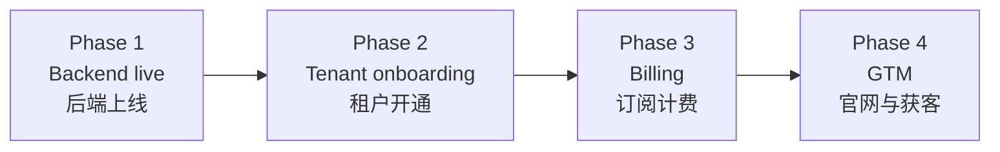

# EmberCore SaaS Roadmap / SaaS 上线路线图

**Product / 产品:** EmberCore · **Company / 公司:** EmberSoulLabs (SSM) · **Domain / 域名:** [embersoullabs.com](https://embersoullabs.com)  
**Firebase production / 生产项目:** `embercore-erp` · **App version / 版本:** v1.0.3 (10)

Actionable checklists for **Phase 1–4**. Check items off as you complete them.  
**Phase 1–4** 可执行清单 — 完成一项勾一项。

**Related / 相关:** [INTERNAL_TO_SAAS_ERP.md](INTERNAL_TO_SAAS_ERP.md) · [TECH_STACK.md](TECH_STACK.md) · [FIREBASE_STRUCTURE.md](FIREBASE_STRUCTURE.md) · [STAGING.md](STAGING.md) · [FEATURES.md](FEATURES.md)

---

## Overview / 总览



| Phase | Goal (EN) | 目标 (中文) | Done when / 完成标准 |
|-------|-----------|-------------|----------------------|
| **1** | New Firebase project runs core business | 新 Firebase 能跑通核心业务 | superadmin logs in, creates order, prints |
| **2** | Self-serve signup + approval provisioning | 客户申请 + 审批自动开通 | Register → approve → tenant live without manual Console |
| **3** | Charge florists for SaaS | 向花店收订阅费 | Plan, trial, payment, expiry enforcement |
| **4** | Sell and operate compliantly | 对外销售与合规 | Website, pricing, legal, app stores |

---

# Phase 1 — Backend live / 后端上线

> **Goal:** `embercore-erp` has full backend; Web · Android · iOS connect and core flows work.  
> **目标：** 部署完整后端，三端可连接并完成核心业务流程。

## 1.1 Repo & tools / 仓库与工具

- [ ] Copy `firebase/` from `tfg_vday` into this repo (exclude `node_modules`, `public`, `keys/*.json`)
- [ ] Install Flutter SDK, Node.js 18+, Firebase CLI
- [ ] Run `firebase login`
- [ ] Run `npm install` in `firebase/` and `firebase/functions/`
- [ ] Download `embercore-erp` service account → `firebase/keys/embercore-erp-serviceAccount.json` (**never commit**)

## 1.2 Firebase project wiring / 项目配置

- [ ] Update `firebase/.firebaserc`: `production` → `embercore-erp`
- [ ] (Optional) Create staging project `embercore-erp-staging` and add to `.firebaserc`
- [ ] Confirm Blaze plan (required for Cloud Functions)

## 1.3 Console services / 启用服务

In Firebase Console → `embercore-erp`:

- [ ] **Authentication** — Email/Password enabled
- [ ] **Authentication** — **Disable public signup** (staff created by admins only)
- [ ] **Firestore** — Create database (region `asia-southeast1` recommended)
- [ ] **Storage** — Default bucket enabled
- [ ] **Hosting** — Linked to Web app
- [ ] **Cloud Messaging** — Enabled
- [ ] **Crashlytics** — Enabled (mobile)
- [ ] **Performance Monitoring** — Enabled
- [ ] **App Check** — Start in **monitoring** mode (do not enforce yet)

## 1.4 Client Firebase config / 客户端配置核对

- [ ] Android `google-services.json` → `com.embersoullabs.embercore_erp`
- [ ] iOS `GoogleService-Info.plist` → `com.embersoullabs.embercore-erp`
- [ ] Web `lib/backend/firebase/firebase_config.dart` → `appId: 1:1098308969895:web:15747b5faa30917cff8282`
- [ ] `lib/backend/firebase/app_environment.dart` → production = `embercore-erp`

## 1.5 Deploy rules, indexes, storage / 部署规则与存储

```powershell
cd firebase
$env:GOOGLE_APPLICATION_CREDENTIALS = "...\embercore-erp-serviceAccount.json"
firebase deploy --only firestore:rules,firestore:indexes,storage --project embercore-erp
```

- [ ] Firestore Rules deployed
- [ ] Firestore Indexes deployed (wait for index build in Console)
- [ ] Storage Rules deployed
- [ ] Storage CORS applied (Web image uploads) — `apply_storage_cors.js --project embercore-erp`
- [ ] `npm run test:firebase` passes (recommended)

## 1.6 Deploy Cloud Functions / 部署云函数

```powershell
firebase deploy --only functions --project embercore-erp
```

- [ ] `shopifyOrderCreated` deployed
- [ ] Staff notice FCM trigger deployed
- [ ] Region `asia-southeast1`

## 1.7 Bootstrap platform data / 初始化平台数据

### Superadmin

- [ ] Create Auth user in Console (e.g. `admin@embersoullabs.com`)
- [ ] Run `node scripts/set_user_role.js --project embercore-erp --email ... --role superadmin`
- [ ] Firestore `users/{uid}` exists with `role: superadmin`

### First tenant (demo) / 第一家租户

- [ ] Create `Companies/{companyId}` (`is_active: true`)
- [ ] Run `node scripts/init_counters.js --project embercore-erp --company-id {companyId}`
- [ ] Create `role_permissions/{companyId}`
- [ ] Create `staff_roles/{companyId}`
- [ ] Create `product_categories/{companyId}` (or seed script)
- [ ] Add at least one test product

### First tenant director (optional) / 租户管理员

- [ ] Auth user + `users/{uid}` (`role: director`, `companyRef` → demo company)
- [ ] Login shows only that company's data

## 1.8 Build & deploy Web / 构建部署 Web

```powershell
flutter build web --release
# Copy build/web → firebase/public
firebase deploy --only hosting --project embercore-erp
```

- [ ] https://embercore-erp.web.app loads
- [ ] Login page shows **EmberCore**
- [ ] superadmin → Select Company → Dashboard
- [ ] (Optional) Custom domain `app.embersoullabs.com`

## 1.9 Mobile verification / 移动端验证

- [ ] Android production APK builds
- [ ] Android device: login + create order
- [ ] iOS Xcode build (Apple Developer account)
- [ ] iOS device: login test
- [ ] Bluetooth thermal print (Android/iOS)

## 1.10 Core flow smoke test / 核心流程冒烟

- [ ] Retail POS checkout → `completed`
- [ ] Delivery order → status flow to `completed`
- [ ] Order IDs auto-generated (`TFG-MMMYY-000n` / `WI000n`)
- [ ] Customer CRUD + link on create order
- [ ] PDF delivery slip / invoice
- [ ] Thermal receipt
- [ ] Driver login → My Deliveries only
- [ ] Assign driver + delivery proof upload
- [ ] Staff notice bell
- [ ] Offline queue flush on reconnect

## 1.11 Security & ops / 安全与运维

- [ ] Service account / `key.properties` / `.env` not in git
- [ ] Tenant isolation verified (non-superadmin cannot read other `companyRef`)
- [ ] Storage rules block unauthorized uploads
- [ ] Firestore backup plan (scheduled export or Console backups)
- [ ] Update internal docs: production URL → `embercore-erp.web.app`

### Phase 1 complete when / 完成标志

> superadmin completes **login → select company → create order → update status → print** on Web + at least one mobile platform; Rules, Functions, and Hosting are deployed.

---

# Phase 2 — Tenant onboarding / 租户开通

> **Goal:** New florists apply online; platform approves and provisions tenant without manual Console edits.  
> **目标：** 注册申请 → 审批 → 自动建租户，无需手改 Firestore。

## 2.1 Registration request (partially built) / 注册申请

Already in app / 已有:

- [x] `/userSignup` page
- [x] Writes `user_registration_requests` (`status: pending`)

Still needed / 待完成:

- [ ] Firestore rules: allow **create** on `user_registration_requests` for applicants (no read of others)
- [ ] Storage rules: `user_registration_logos/` for signup uploads
- [ ] Success copy: “Submitted — pending review”

## 2.2 Superadmin approval UI / 审批界面

- [x] **Registration Requests** admin page (superadmin only) — `/registrationRequests`
- [x] List: filter pending / approved / rejected
- [x] Detail: applicant, company fields, logo preview
- [x] Actions: **Approve** / **Reject** (with note) — MVP via client; migrate to §2.3 Function

## 2.3 Auto-provision Cloud Function / 自动开通

On approve, automatically / 批准时自动:

- [ ] Create Firebase Auth user (or password-reset email)
- [ ] Create `Companies/{companyId}`
- [ ] Create `users/{uid}` (`role: director`, `companyRef`)
- [ ] Init `counter/{companyId}_delivery` + `_retail`
- [ ] Init `role_permissions/{companyId}`
- [ ] Init `staff_roles/{companyId}`
- [ ] Init `product_categories/{companyId}`
- [ ] Set request `status: approved`
- [ ] Welcome email / notification (optional)

## 2.4 Tenant lifecycle / 租户生命周期

- [ ] superadmin deactivate tenant (`Companies.is_active = false` → staff blocked)
- [ ] superadmin create tenant without signup flow
- [ ] Tenant list: name, status, created, staff count
- [ ] Tenant data export (offboarding / compliance)

## 2.5 Staging environment / 测试环境

- [ ] Firebase project `embercore-erp-staging`
- [ ] Android staging app + `google-services.json`
- [ ] Web staging app + `firebase_config.dart` staging block
- [ ] Deploy rules / functions / hosting to staging
- [ ] `bootstrap:staging` test superadmin + demo company
- [ ] Release process: **staging smoke → production**

## 2.6 White-label basics (optional) / 白标基础

- [ ] Configurable order ID prefix (replace fixed `TFG-` with `EC-` or per-tenant)
- [ ] Receipt/PDF header uses tenant `Company_name` + logo
- [ ] Login shows EmberSoulLabs platform brand

### Phase 2 complete when / 完成标志

> New florist submits signup → superadmin approves → director logs in and creates first order with **no manual Firestore edits**.

---

# Phase 3 — Subscription billing / 订阅计费

> **Goal:** EmberSoulLabs charges florists monthly/yearly; expired tenants are limited.  
> **目标：** 套餐、试用、收款、到期停用。

## 3.1 Plan design / 套餐设计

**Canonical spec:** [PRICING_PLANS.md](PRICING_PLANS.md)

| Plan | Monthly (MYR) | Staff cap | Orders/mo | Upgrade hook |
|------|---------------|-----------|-----------|--------------|
| Starter | RM 69 / S$ 29 | 2 | 500 | Core ERP + CSV import/export |
| Pro | RM 199 / S$ 79 | 10 | 3,000 | WhatsApp · Shopify · BOM · audit |
| Business | RM 399 / S$ 159 | 30 | 10,000 | Higher limits · priority support |

- [x] Tier feature matrix documented
- [ ] Stripe Price IDs (MYR) + Functions `PLAN_LIMITS` aligned
- [ ] `plan_tier` gates `PlatformModule` (Pro modules locked on Starter)
- [ ] Broadcast quota (Pro 2k/mo, Business unlimited)
- [ ] Free trial 14 days (Firestore trialing — not Stripe trial)
- [ ] Annual discount (optional second Price per tier)

## 3.2 Data model / 数据模型

On `Companies` or `subscriptions/{companyId}`:

- [ ] `plan_tier` (starter / pro / business)
- [ ] `subscription_status` (trialing / active / past_due / cancelled)
- [ ] `trial_ends_at`
- [ ] `current_period_end`
- [ ] `stripe_customer_id` / `stripe_subscription_id` (or local PSP IDs)
- [ ] `max_staff_seats`
- [ ] `max_orders_per_month`

## 3.3 Payment integration / 支付集成

Choose one or more (Malaysia) / 马来西亚可选:

- [ ] **Stripe**
- [ ] **Billplz** / **ToyyibPay** / **Revenue Monster** (FPX / e-wallets)
- [ ] Cloud Function: payment success → update `subscription_status`
- [ ] Cloud Function: payment failed → `past_due` + notify
- [ ] Webhook signature verification

## 3.4 In-app billing UX / 应用内计费

- [ ] **Billing** page (director / superadmin): plan, renewal date, upgrade/downgrade
- [ ] Trial ending reminders (in-app + email)
- [ ] `past_due` / `cancelled` → restrict creates (read-only or block orders)
- [ ] superadmin manual extension / comp trial

## 3.5 Usage metering (optional) / 用量计量

- [ ] Monthly order count vs `max_orders_per_month`
- [ ] Staff count vs `max_staff_seats`
- [ ] Storage usage per tenant

## 3.6 Finance & tax / 财务税务

- [ ] SaaS invoices from EmberSoulLabs (separate from in-app **customer** invoices)
- [ ] SST if applicable
- [ ] Accounting export (QuickBooks / Xero / local)

### Phase 3 complete when / 完成标志

> Test tenant subscribes to Pro via checkout; full access until period end; after expiry app prompts renewal and blocks new orders.

---

# Phase 4 — Go-to-market / 官网与获客

> **Goal:** Strangers discover product at embersoullabs.com, start trial, and you operate legally.  
> **目标：** 官网获客、合规文档、应用商店。

## 4.1 Marketing site (embersoullabs.com) / 官网

- [ ] Homepage: value prop + screenshots / demo video
- [ ] Features: POS, delivery, reports, multi-store
- [ ] **Pricing** page + CTA “Start free trial”
- [ ] About: EmberSoulLabs SSM
- [ ] Contact / book demo form
- [ ] CTA → `/userSignup` or `app.embersoullabs.com`

## 4.2 Distribution / 应用分发

- [ ] Web: `app.embersoullabs.com` or `embercore-erp.web.app`
- [ ] Google Play: listing, screenshots, privacy policy URL
- [ ] Apple App Store: TestFlight + review assets
- [ ] Direct APK for peak-season clients (optional)

## 4.3 Legal (Malaysia) / 法律合规

- [ ] Terms of Service
- [ ] Privacy Policy (PDPA 2010) — draft: [legal/PRIVACY_POLICY_DRAFT.md](legal/PRIVACY_POLICY_DRAFT.md); lawyer review before publish
- [ ] Cookie policy (Web)
- [ ] Data Processing Agreement template (B2B)
- [ ] In-app links + consent on signup

## 4.4 Customer support / 客户支持

- [ ] support@embersoullabs.com
- [ ] Ticketing (Zendesk / Freshdesk / form)
- [ ] Onboarding docs (EN + 中文)
- [ ] Video tutorials
- [ ] SLA (response times, peak support)

## 4.5 Marketing & analytics / 营销分析

- [ ] Analytics: site → signup → activation → paid
- [ ] Email: trial ending, product updates
- [ ] Pilot customers (3–5) + feedback loop

## 4.6 Brand consistency / 品牌统一

- [ ] Firebase app nicknames → **EmberCore** (not EmberCore ERP)
- [ ] External copy: **EmberCore by EmberSoulLabs**
- [ ] App icon / favicon refresh
- [ ] Order ID prefix branding (`EC-` or per-tenant)

### Phase 4 complete when / 完成标志

> Prospect finds embersoullabs.com → views pricing → starts trial → completes first order within 14 days → receives renewal prompt and can pay.

---

# Appendix A — Built vs missing / 已有 vs 待建

| Capability | Status |
|------------|--------|
| Per-tenant platform config (`tenant_platform_config`) | ✅ Built → [GENERIC_PLATFORM.md](GENERIC_PLATFORM.md) |
| Multi-tenant ERP (17 modules) | ✅ Built |
| 10 roles + 33 permissions | ✅ Built |
| Firebase apps on `embercore-erp` | ✅ Registered |
| `firebase/` deploy folder in this repo | ⬜ Copy from `tfg_vday` |
| Signup request submit | ✅ Built |
| Signup approve + auto provision | ⬜ Client MVP done; Cloud Function pending |
| Subscription billing | ⬜ Not built |
| Marketing site + legal | ⬜ Not built |
| Shopify / WhatsApp integrations | ✅ Code exists; configure webhooks on new project |

---

# Appendix B — Key paths / 关键路径

| Purpose | Path |
|---------|------|
| Firebase client init | `lib/backend/firebase/firebase_config.dart` |
| Environment switch | `lib/backend/firebase/app_environment.dart` |
| Branding | `lib/app_branding.dart` |
| Signup requests | `lib/backend/user_registration_request_helpers.dart` |
| Tenant context | `lib/backend/tenant_context.dart` |
| Android Firebase | `android/app/src/production/google-services.json` |
| iOS Firebase | `ios/Runner/GoogleService-Info.plist` |
| Backend deploy | `firebase/` (migrate from `tfg_vday`) |
| Schema | [DATABASE_SCHEMA.md](DATABASE_SCHEMA.md) |
| Permissions | [PERMISSION_MATRIX.md](PERMISSION_MATRIX.md) |

---

# Appendix C — Suggested timeline / 建议时间线

| Phase | Estimate | Depends on |
|-------|----------|------------|
| 1 | 3–7 days | Firebase access, service account |
| 2 | 2–4 weeks | Phase 1 |
| 3 | 2–3 weeks | Phase 2, payment merchant account |
| 4 | 2–4 weeks | Can overlap with Phase 3 |

---

*Roadmap for EmberCore by EmberSoulLabs · app v1.0.3 (10) · last updated 2026-06-17.*
